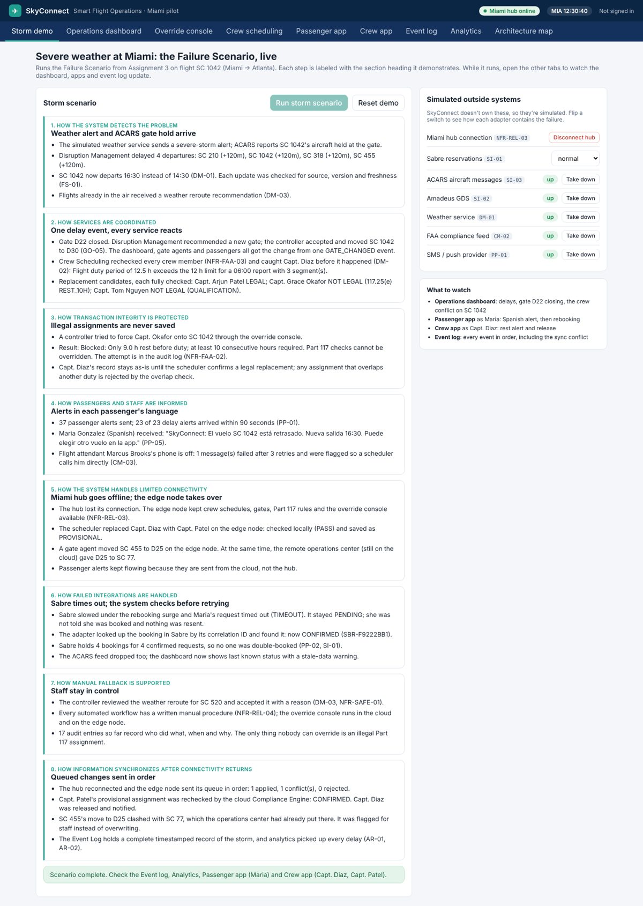
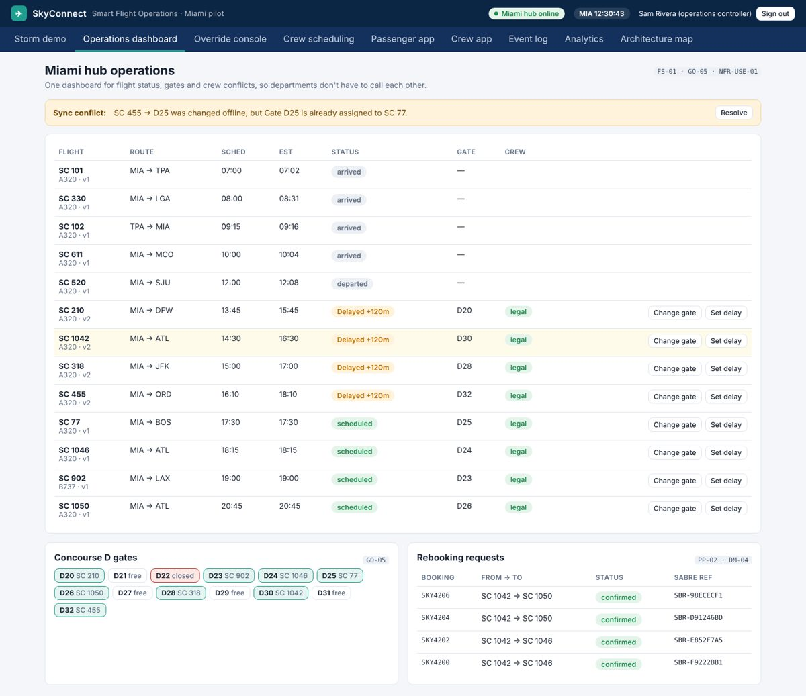
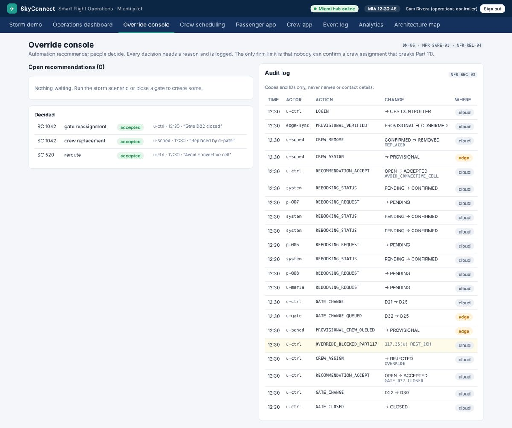
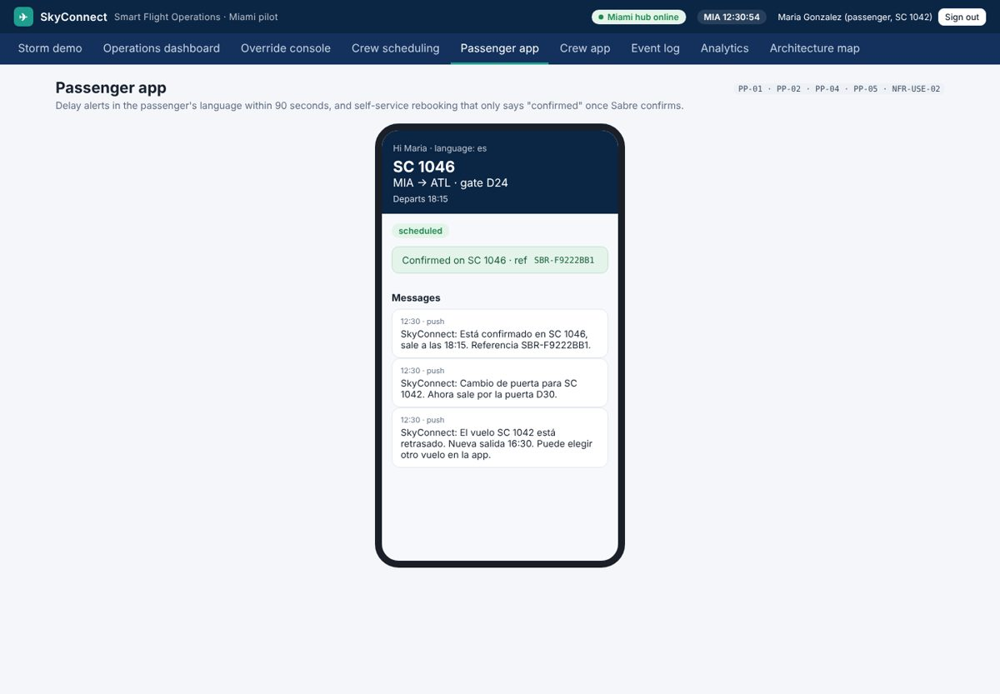
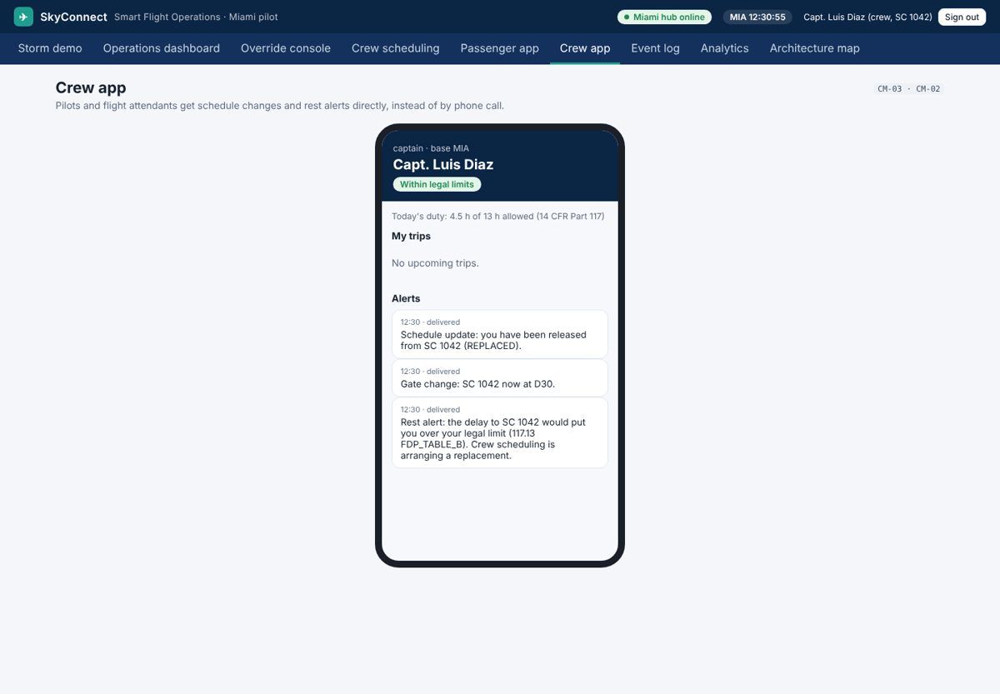
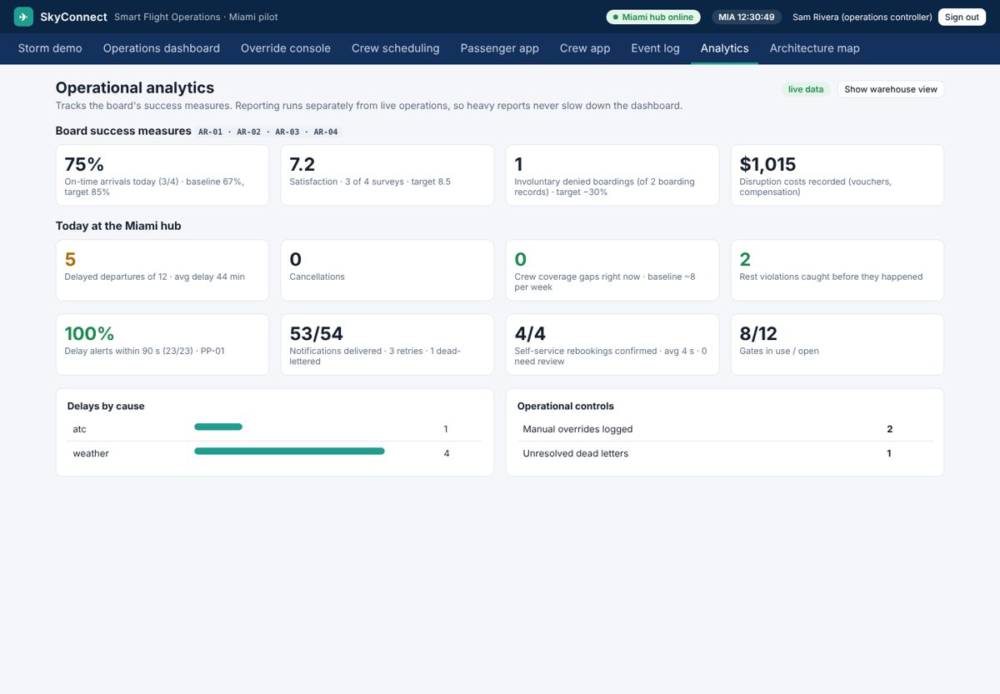
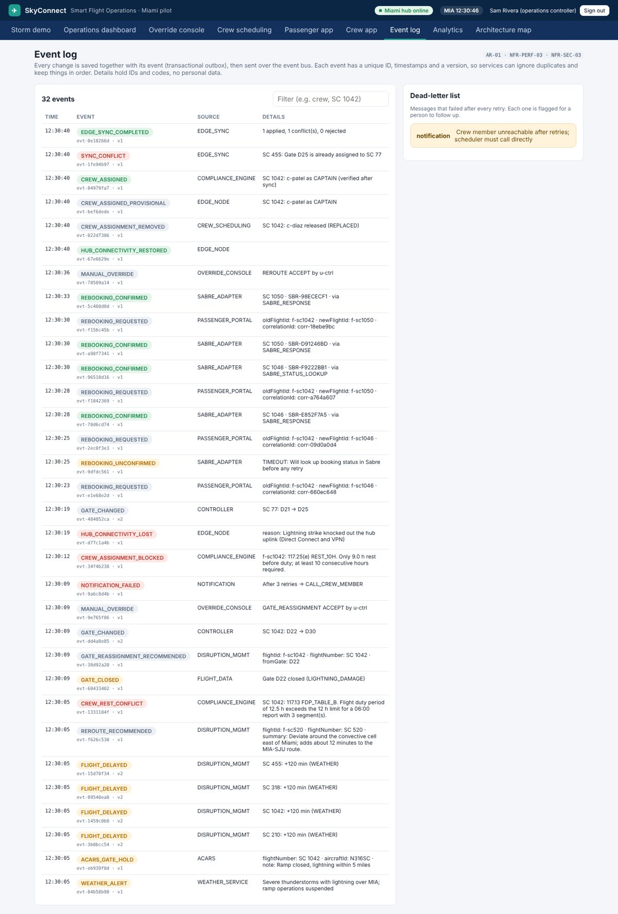

# SkyConnect Smart Flight Operations: Miami Pilot Prototype

A working prototype of the **SkyConnect Airlines Smart Flight Operations Management System**, built from our BTE 360 Assignment 3 architecture (University of Miami). It runs the Miami hub pilot: real-time flight status, automated crew scheduling with FAA rest checks, self-service passenger rebooking, and proactive delay notifications. It also acts out the **severe-weather Failure Scenario** from the report, live.

**Team:** Olivia Janse Van Rensburg · Amanie Bhakta · Elle Price · Margaret Haddad



---

## Run it

You need [Node.js](https://nodejs.org) 20 or newer.

```bash
git clone https://github.com/ecp111/skyconnect-smart-flight-ops.git
cd skyconnect-smart-flight-ops
npm install
npm start
```

Then open **http://localhost:3000**. Everything runs locally with fictional data. The outside airline systems are simulated, so no accounts or keys are needed.

| Command | What it does |
|---|---|
| `npm start` | Build the interface and start the app on port 3000 |
| `npm test` | Run the 44 automated tests (each one names the requirement it verifies) |
| `npm run dev` | Development mode with live reload (interface on port 5173) |

---

## 5-minute demo script

1. **Storm demo** tab → **Run storm scenario**. Eight steps play out over about 30 seconds. Each step uses a heading from our Failure Scenario section.
2. **Operations dashboard** → sign in as *Sam Rivera (operations controller)*. This account has elevated access, so it asks for MFA; click **Use demo code**. You'll see:
   - the delays
   - SC 1042 moved from the closed gate D22 to D30
   - a **sync conflict** banner from the edge node
3. **Passenger app** → sign in as *Maria Gonzalez*. She got her alerts in Spanish and is confirmed on SC 1046. This happened even though Sabre timed out during her request.
4. **Crew app** → sign in as *Capt. Luis Diaz*. He got a rest alert, then was released from SC 1042. Capt. Arjun Patel replaced him.
5. **Override console** → the audit log shows the blocked attempt to force Capt. Okafor onto the flight. This is Part 117: nobody can override it.
6. **Event log** and **Analytics** → the full timestamped record and the board's success measures.

Use **Reset demo** to start over. On the Storm demo tab you can also flip any outside system yourself: Sabre slow, timing out or down; ACARS down; hub disconnected.

---

## How it follows the Assignment 3 architecture

| Report section | Where it is in the code |
|---|---|
| Conceptual Architecture: microservices, event-driven, API-based (ADR-01) | `server/services/`, one module per service · `server/bus/eventBus.ts` · `server/integration/adapters.ts` |
| Services communicate synchronously and asynchronously (ADR-02) | `crewScheduling.assign()` waits for the Compliance Engine · `notification.ts` reacts to events |
| Cloud Architecture: hybrid AWS + hub edge node (ADR-03, ADR-05) | `server/edge/edgeNode.ts` · see the mapping table below |
| Database Architecture (ADR-04) | `server/db/schema.sql`: FLIGHT, GATE_ASSIGNMENT, CREW_ASSIGNMENT, REST_CHECK, REBOOKING, OPERATIONS_EVENT, AUDIT_LOG… |
| Integrated Architecture: users, gateway, zones | `server/app.ts` (API gateway) · `server/gateway/auth.ts` (SSO, roles, MFA) |
| Manual override design (ADR-06) | `server/services/override.ts` |
| Zone separation (ADR-07) | Passenger services only react to events; they never write flight or crew data |
| Failure Scenario | `server/scenario/storm.ts` |
| Architecture Decision Log | [`docs/adr/`](docs/adr) |
| Requirements Traceability Matrix | [`docs/requirements-traceability.md`](docs/requirements-traceability.md) (requirement → code → test) |

### Production design → prototype

To keep the prototype a one-command install, a few production pieces are replaced with local equivalents. They keep the same behavior.

| In the report | In this prototype |
|---|---|
| Amazon EventBridge | In-process event bus with a transactional outbox and idempotent consumers |
| Amazon RDS (PostgreSQL) | SQLite with the same tables, keys, CHECK rules and ACID transactions |
| AWS containers, one per service | One Node.js process; each service is its own module and only talks to others through the bus |
| Data warehouse | Analytics snapshot refreshed every 30 s, plus a live view for controllers |
| Miami hub edge server | Separate edge tables and a local copy of the Part 117 rules; you can switch it offline |
| Sabre, Amadeus, ACARS, weather, FAA, MRO, SMS/push, payments | Simulators with switches for slow, timeout and down |
| SSO + MFA identity provider | Demo sign-in with roles; elevated roles need a 6-digit code |

---

## Key behaviors

**Crew legality.** Before any crew assignment is saved, it goes through the Compliance Engine. Pilots are checked against Part 117 and flight attendants against 14 CFR 121.467. The checks cover:
- 10-hour rest before duty
- Table B flight duty limits
- 60 hours of flight duty in any 168 hours
- 30 consecutive hours off in any 168 hours
- aircraft qualification
- overlapping duties

When a flight is delayed, its crew is rechecked automatically. In the demo, the 2-hour delay pushes Capt. Diaz to 12.5 h against a 12 h limit, and the system catches it before it happens.

**PENDING before Sabre.** A rebooking is saved as PENDING with a unique correlation ID *before* Sabre is called. If Sabre times out, the request stays PENDING. The adapter then asks Sabre for the booking status before trying again, so a passenger is never told "booked" early and is never booked twice.

**Edge node.** When the hub goes offline, staff keep working on the edge node. Changes are queued with a sequence number and the version they were based on. Crew changes are checked locally and saved as PROVISIONAL. When the hub reconnects, the queue syncs in order: duplicates are skipped, conflicts are flagged for staff, and provisional crew changes are re-verified in the cloud.

**Notifications.** Passengers get alerts in English, Spanish, Portuguese or Haitian Creole. Failed messages are retried three times, then dead-lettered. If it's a crew member, a scheduler is flagged to phone them.

---

## Project layout

```
server/
  app.ts               API gateway (routes, roles)
  system.ts            wires every service together
  core.ts              simulated clock, IDs, time helpers
  db/                  schema.sql and Miami seed data
  bus/                 event bus with outbox and idempotent consumers
  gateway/             sign-in, roles, MFA
  services/            flightOps, disruption, crewScheduling, compliance,
                       rebooking, notification, override, analytics
  integration/         one adapter per outside system
  simulators/          simulated Sabre, Amadeus, ACARS, weather, FAA, MRO, SMS/push, payments
  edge/                Miami hub edge node
  scenario/            the storm scenario
web/src/               React interface (one file per screen in pages/)
tests/                 automated tests, named after the requirements they verify
docs/                  ADRs, traceability, screenshots
```

---

## Limitations and notes

- **Not a certified compliance tool.** The Part 117 and 121.467 rules are simplified for teaching.
- **All data is fictional:** people, bookings and aircraft registrations.
- **Translations need review.** The Spanish, Portuguese and Haitian Creole templates should be checked by native speakers.
- **A few features aren't built yet:**
  - voucher and lounge access (PP-03, a Should Have)
  - MRO integration beyond the simulator (SI-04)
  - additional hubs (NFR-SCAL-02 is designed for, but only Miami is seeded)
- **Built with AI assistance.** The code was written with help from Claude (Anthropic), following our group's Assignment 3 design. This is listed in our AI-use declaration.

## Screenshots

| Operations dashboard | Override console |
|---|---|
|  |  |
| **Passenger app** | **Crew app** |
|  |  |
| **Analytics** | **Event log** |
|  |  |
